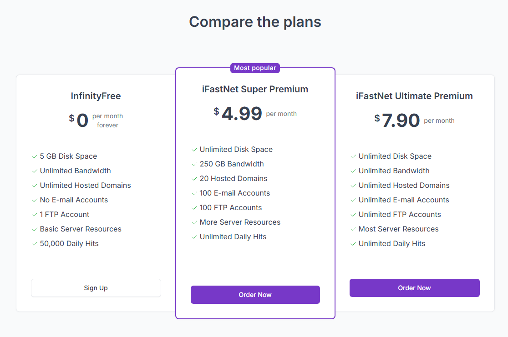
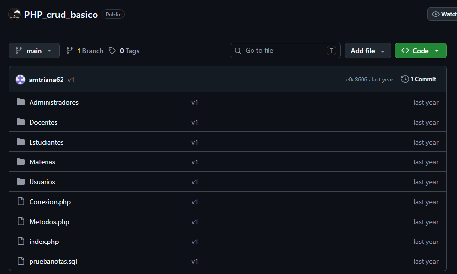
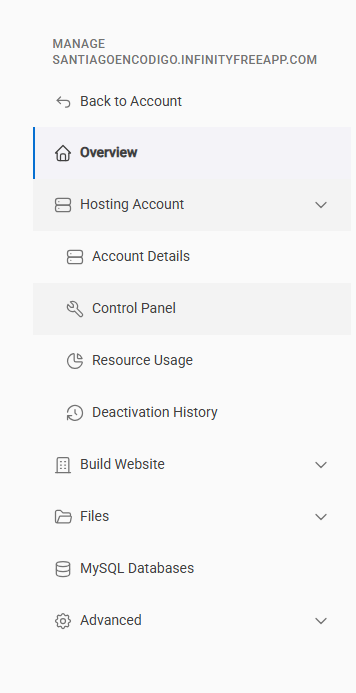
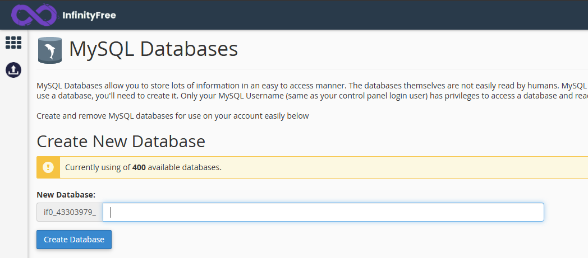
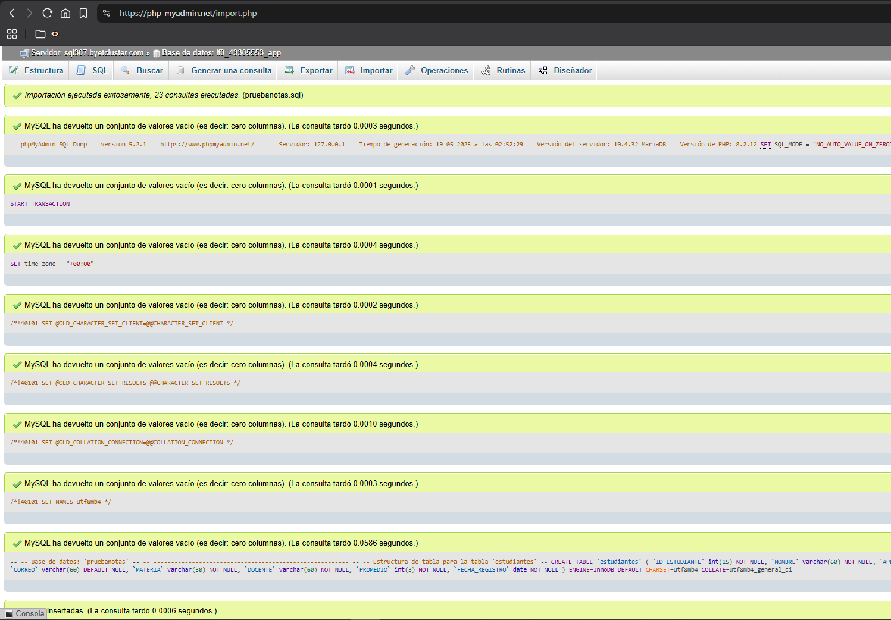
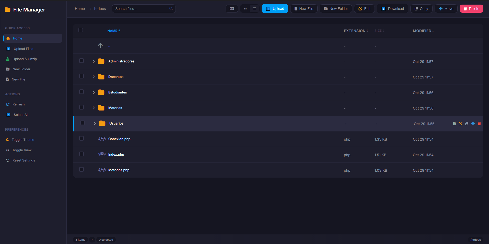
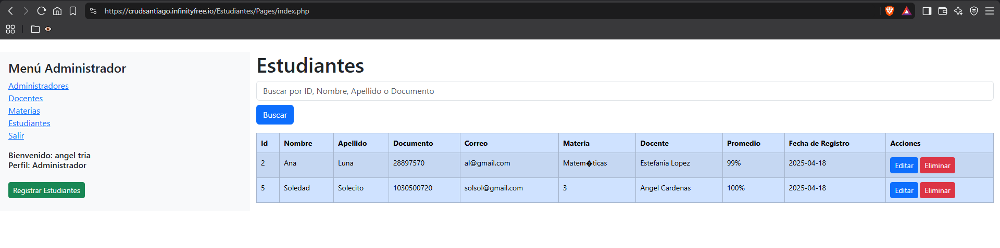

# Despliegue de software en InfinityFree

Documentación del proceso de despliegue de una aplicación web utilizando el servicio de alojamiento gratuito InfinityFree. Esta guía cubre la investigación del servicio, la configuración inicial, la creación de la base de datos, la carga de archivos y la resolución de errores.

Competencia: Implementar la solución de software de acuerdo con los requisitos de operación y modelos de referencia.
Resultado de Aprendizaje: Desplegar el software de acuerdo con la arquitectura y las políticas establecidas.

## Tabla de contenido

1. [Investigación del servicio de alojamiento](#investigación-del-servicio-de-alojamiento)
2. [Puesta en marcha y registro](#puesta-en-marcha-y-registro)
3. [Creación de la base de datos](#creación-de-la-base-de-datos)
4. [Importación de la base de datos](#importación-de-la-base-de-datos)
5. [Carga de archivos del proyecto](#carga-de-archivos-del-proyecto)
6. [Configuración de la conexión](#configuración-de-la-conexión)
7. [Pruebas y solución de errores](#pruebas-y-solución-de-errores)

## Investigación del servicio de alojamiento

Antes de iniciar el despliegue, es necesario comprender el margen de maniobra técnico y las limitaciones del servicio gratuito.

### Características de alojamiento gratuito

InfinityFree proporciona un entorno real para PHP y MySQL. Según las especificaciones del servicio, las características principales son:

- 5 GB de espacio en disco.
- Ancho de banda ilimitado.
- PHP 8.3.
- MySQL 8.0 / MariaDB 10.6.
- Nombres de subdominios gratuitos.
- Traiga su propio dominio (dominios personalizados).
- 400 bases de datos MySQL.
- Servicio de DNS gratuito.
- Certificados SSL gratuitos.
- Soporte completo para `.htaccess`.

A continuación, se muestra una comparativa de precios del servicio:



*Captura tomada de https://www.infinityfree.com/premium/*

### Restricciones críticas del plan gratuito

El plan gratuito de $0 presenta limitaciones estrictas que determinan si un proyecto es viable en este entorno:

- Sin cuentas de correo electrónico (Email Accounts).
- Sin panel de control cPanel (se utiliza VistaPanel).
- Hits no ilimitados (límite diario).
- Sin selección de versión de PHP.
- Sin soporte para la función `PHP mail()`.
- Sin administración completa de DNS (Full DNS Management).
- Sin soporte para MySQL remoto.
- Sin soporte para Python/Node.js.

### Concepto de hit

Un hit representa cada petición HTTP individual que llega al servidor. No equivale a un visitante único; incluye todos los archivos que el navegador debe cargar (HTML, CSS, JS, imágenes). 

> Advertencia: En proyectos con múltiples páginas y recursos, el consumo de hits puede ser elevado por visita. Si una página carga 1 HTML, 1 CSS, 1 JS y 3 imágenes, se registran 6 hits por visita. El límite se reinicia diariamente.

## Puesta en marcha y registro

El primer paso consiste en descargar el repositorio base del proyecto:
https://github.com/trianagel/PHP_crud_basico



Extraiga el repositorio en una carpeta local para su revisión. Verifique la estructura de carpetas y el número de archivos.

A continuación, registre una cuenta en InfinityFree:

1. Ingrese a https://www.infinityfree.com/ y cree una cuenta.
2. Seleccione la opción de plan gratuito (0 por mes) y haga clic en `Create Now`.
3. Espere la verificación del sistema.
4. Asigne un nombre al subdominio (por ejemplo, `tests-ventas`) y seleccione la extensión `infinityfreeapp.com`. Verifique la disponibilidad.
5. Complete la información adicional. Genere una contraseña segura (entre 8 y 15 caracteres, letras y números) y guárdela. Esta contraseña será utilizada para el panel de control y la base de datos.
6. En la opción de consentimiento de correo (Email Consent), seleccione `I Do Not Approve`.
7. Haga clic en `Create Account` y espere a que el sistema confirme que la cuenta está lista.

> Nota: Es importante utilizar la plataforma en su idioma original (inglés) para evitar errores de traducción que puedan afectar el despliegue.

## Creación de la base de datos

Desde el panel principal de la cuenta, haga clic en `Control Panel`.



En la sección `Databases`, seleccione `MySQL Databases` (no ingrese directamente a phpMyAdmin).



1. En el campo `New Database`, asigne un nombre (por ejemplo, `app`).
2. Haga clic en `Create Database`.
3. El sistema generará las credenciales de conexión. Es fundamental guardar esta información de forma segura:

| Parámetro | Valor de ejemplo | Descripción |
| :--- | :--- | :--- |
| Nombre de la BD | `if0_39370677_app` | Nombre de la base de datos con prefijo. |
| Nombre de usuario | `if0_39370677` | Usuario generado automáticamente. |
| Contraseña | *(Tu contraseña del vPanel)* | La clave creada en el registro. |
| Nombre del host | `sql101.infinityfree.com` | Servidor de la base de datos. |

> Solución de problemas: Si phpMyAdmin muestra un error de tiempo de espera o no lista la base de datos recién creada, cierre sesión, borre la caché del navegador y vuelva a ingresar.

## Importación de la base de datos

Una vez creada la base de datos, regrese a la sección `MySQL Databases` y haga clic en el botón `Admin` correspondiente a su base de datos. Esto abrirá phpMyAdmin.

1. Seleccione su base de datos en el menú izquierdo.
2. Diríjase a la pestaña `Importar`.
3. En `Archivo a importar`, seleccione el archivo `.sql` incluido en la carpeta local del proyecto. Asegúrese de que el conjunto de caracteres sea `utf-8`.
4. Desplácese al final y haga clic en `Continuar`.
5. Verifique que la importación se haya ejecutado exitosamente y que las tablas se muestren en el panel izquierdo.



## Carga de archivos del proyecto

Regrese a la página principal de su cuenta en InfinityFree y haga clic en `File Manager`.



1. Ingrese a la carpeta `htdocs`. Elimine cualquier archivo de prueba predeterminado que se encuentre allí.
2. Suba los archivos y carpetas del proyecto local. Puede utilizar la función de arrastrar y soltar o el botón de `Upload`.
3. Si se sube uno a uno, verifique que todos los archivos se hayan transferido correctamente.

> Solución de problemas: Si aparece el error `Either your FTP account quota has been exceeded, or the file upload was blocked by security`, utilice la opción de carga manual (icono de subir) o suba los archivos en grupos más pequeños. A veces, las rutas de archivo muy extensas causan este error.

## Configuración de la conexión

El proyecto debe apuntar a las credenciales de la base de datos remota de InfinityFree. En el `File Manager`, navegue por la carpeta `htdocs` hasta encontrar el archivo de conexión (en este caso, `Conexion.php`).

Haga clic derecho sobre el archivo y seleccione `Edit`.

Modifique las variables con los datos proporcionados por InfinityFree:

```php
<?php
class Conexion {
    private static $instancia = null;
    private $db;
    private $driver = "mysql";
    private $host = "sql101.infinityfree.com"; // Host proporcionado
    private $bd = "if0_39370677_app"; // Nombre de la BD con prefijo
    private $usuario = "if0_39370677"; // Usuario de la BD
    private $contrasena = "TuContrasenaSegura"; // Contraseña del vPanel
    // ...
}
```

> Nota: Asegúrese de editar el archivo mientras la plataforma está en inglés. Guarde los cambios (`Save`) y cierre el editor (`Close`).

## Pruebas y solución de errores

Regrese al panel principal y copie la URL de su sitio web (`Website`). Ábrala en una pestaña nueva del navegador.



> Nota: El sistema puede advertir que el dominio tardará hasta 72 horas en propagarse a nivel global (DNS caching). Sin embargo, el sitio suele estar accesible en minutos.

Navegue por la aplicación y verifique los enlaces del menú y el funcionamiento del CRUD. Si encuentra errores en el código original, complete la siguiente tabla de acuerdo con los requerimientos de la actividad:

| Descripción del problema/error | Código antes de la solución | Código después de la solución |
| :--- | :--- | :--- |
| *Ejemplo: El enlace del menú apunta a una ruta local absoluta.* | `<a href="C:/xampp/htdocs/...">` | `<a href="./index.php">` |
| | | |

Enlace del proyecto desplegado:
https://crudsantiago.infinityfree.io/