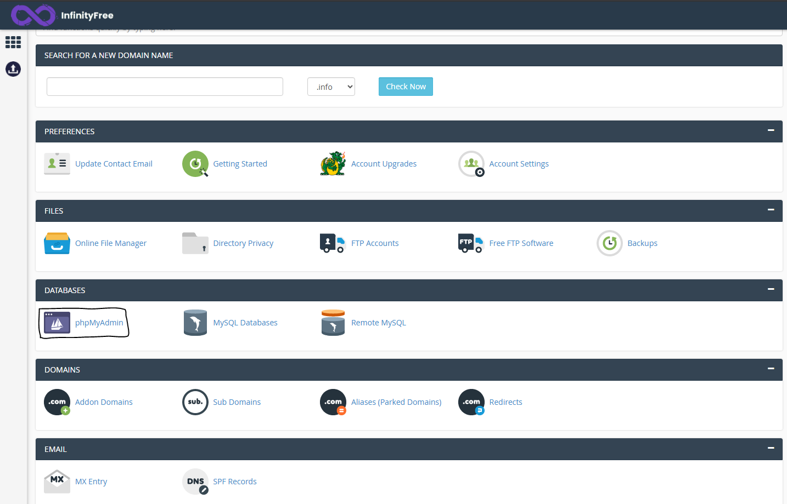
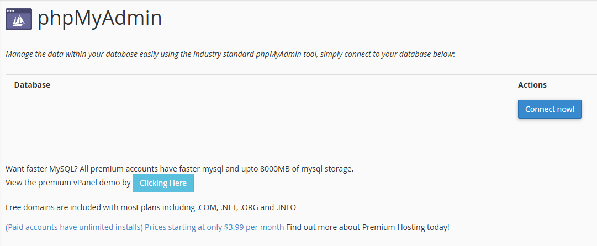

# Desplegar el software: infinityfree

A continuación mi documentación para hacer el despliegue de una aplicación mediante **infinityfree**

La competencia correspondiente a esto es: Implementar la solución de software de acuerdo con los requisitos de operación y modelos de referencia.

Por lo que veo termina siendo como la primera actividad para poner en marcha una aplicación web, primera configuración en el servidor y pues me siento emocionado, vamos a ver qué sucede.

> Este documento aun esta pendiente. Aun no termino el proceso de la implantación.


---


## Tabla de Contenido

1. [Caracteristicas y Restricciones del Servicio de Alojamiento](#caracteristicas-y-restricciones-del-servicio-de-alojamiento)
2. [Puesta en marcha](#puesta-en-marcha)
3. [Creación de Base de Datos](#creación-de-base-de-datos)
4. []()


---


##  Caracteristicas y Restricciones del Servicio de Alojamiento

En cualquier alojamiento web, las características definen tu “margen de maniobra” técnico: espacio en disco, bases de datos, versiones de lenguaje (PHP, etc.), certificados SSL, panel de control o herramientas de instalación. Las restricciones, en cambio, son los topes que evitan que un solo usuario consuma recursos desproporcionados en un servidor compartido.

En un plan gratuito, estas restricciones no son un detalle menor: suelen ser el factor que determina si tu proyecto es viable o no. Los límites más comunes son el consumo de CPU/RAM, el número de archivos (inodos), el tráfico o “hits” diarios, y las funciones bloqueadas (como el envío de correo o la ejecución de tareas programadas).

InfinityFree es un servicio de alojamiento compartido gratuito (sin publicidad inyectada en tus páginas y sin tarjeta de crédito) pensado para aprender, hacer demos o portafolios pequeños. Es un entorno real de PHP y MySQL, pero con límites muy estrictos que lo hacen no apto para producción o tráfico comercial.

Lo que te ofrece (características clave):

PHP 8.3 y MySQL: soporte para WordPress y aplicaciones PHP.

5 GB de disco y 400 bases de datos MySQL (una cifra muy alta para ser gratis).

SSL Let’s Encrypt gratis (automático en subdominios; manual en dominios propios).

Panel VistaPanel (simplificado) y Softaculous para instalar WordPress en un clic.

Subdominios gratuitos y posibilidad de conectar un dominio propio.

Lo que te limita (restricciones críticas):

Límite de 50,000 “hits” diarios: Un “hit” es cada petición HTTP (cargar una página, una imagen, un CSS, un JS). Una sola visita puede consumir 20–50 hits, así que tu techo real es mucho menor de lo que parece.

Tope de ~30,000 archivos (inodos): Se agota antes que los 5 GB de disco. WordPress con varios plugins y caché puede acercarse rápido a este límite.

Sin correo electrónico: No puedes crear cuentas @tudominio.com ni enviar correos desde PHP de forma fiable.

Sin SSH ni Cron: No hay acceso por consola ni tareas programadas; dependencias como Composer deben prepararse en local y subirse por FTP.

Sin soporte directo: Solo foro comunitario y base de conocimiento; no hay tickets ni chat.

Suspensión automática: Por exceder recursos, por inactividad (30 días sin visitas) o por contenido prohibido (proxy, spam, criptominería, etc.).

Ahora bien, para chismosear infinityfree acceda al siguente enlace:

https://www.infinityfree.com/

A continuación una imagen que refleja los precios para comparar


*Captura tomada de https://www.infinityfree.com/premium/*

* Como duda que me surgió 50.000 HITS como limite en el infinity free, un hit quiere decir que es cada peticicón HTTP  individual que llegará al servidor, pero esto no significa unicamente que sea un visitante, es cualquier solicitud al servidor. Es decir todos los archivos que se tienene que cargar. Por lo que si la pagina carga 1 archivo HTML, 1 CSS, 1 JS, 3 imagenes ahí ya son 3 HITS en un momento.

> Me asusta un poco porque tengo proyectos, como este de ADSO que tiene muchas paginas y por cada una hay imagenes, html y demás... Pienso que facilmente por visita se podrian gastar hasta 500 hits.
> Lo bueno, es que esto es diario.


---


## Puesta en marcha

Ahora bien, se nos pide hacer clonación del siguente proyecto: https://github.com/trianagel/PHP_crud_basico correspondiente aun repositorio de la instructora. Y voy a crear mi cuenta con infinityfree.


Y entonces vamos a darle a la selección de bases de datos y haremos click en phpmyadmin



Y entonces ahora empezaremos con la creación de nuestra base de datos



Y entonces hay decidí ejecutar mi XAMPP y escribir localhost en mi navegador para abrir la interfaz y empece a trabajar con eso.

de ahí en consultassql escribi:

```sql
    CREATE DATABASE testinfinityfree;
```

y seleccioné la base de datos.

Y en infinityfree le di a la opción de connect.

De aqui tube mi primer problema, porque no encontraba nada para conectar y cuando le daba... Me aparecia "La pagina se ha demorado mucho en cargar"

Esto es porque la pagina no es para crear una BD, sino que me encuentro ubicado en una para conectar.

Entonces debo salirme de esta interfaz para enn vez de darle a phpmyadmin, darle a mysql databases


de nombre le voy a poner santiagoencodigo.

> Aqui vi entonces que en infinityfree puedo tener hasta 400 bases de datos. Y en este caso ahora puedo 399 porque ya voy una.

Ahora sí, debo volver a phpmyadmin y realizar la conexión.

Y me sigue apareciendo lo mismo en phpmyadmin, entonces para forzar esa actualización de base de datos porque ya esta creada.

De aqui segui con los mismos problemas, por lo que me vi en la situación de querrer ver un video de yutu para informarme

Po lo que fui a ver: https://www.youtube.com/watch?v=GbAKgXaF8jY

> Aun no se responden mis dudas, ¿Por qué será que estoy teniendo problemas en crear  la Base de Datos?

* Cuando la creo en MySQL connection, no se esta creando realmente.

> Tristemente, esperaré a la ayuda de un compañero para solucionar este problema. No encuentro como solucionarlo ni con videos de youtube, ni con IA.


